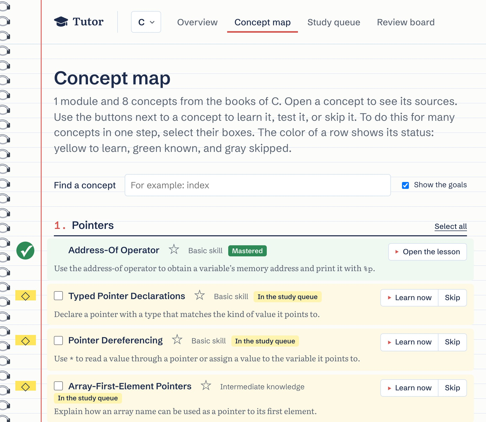
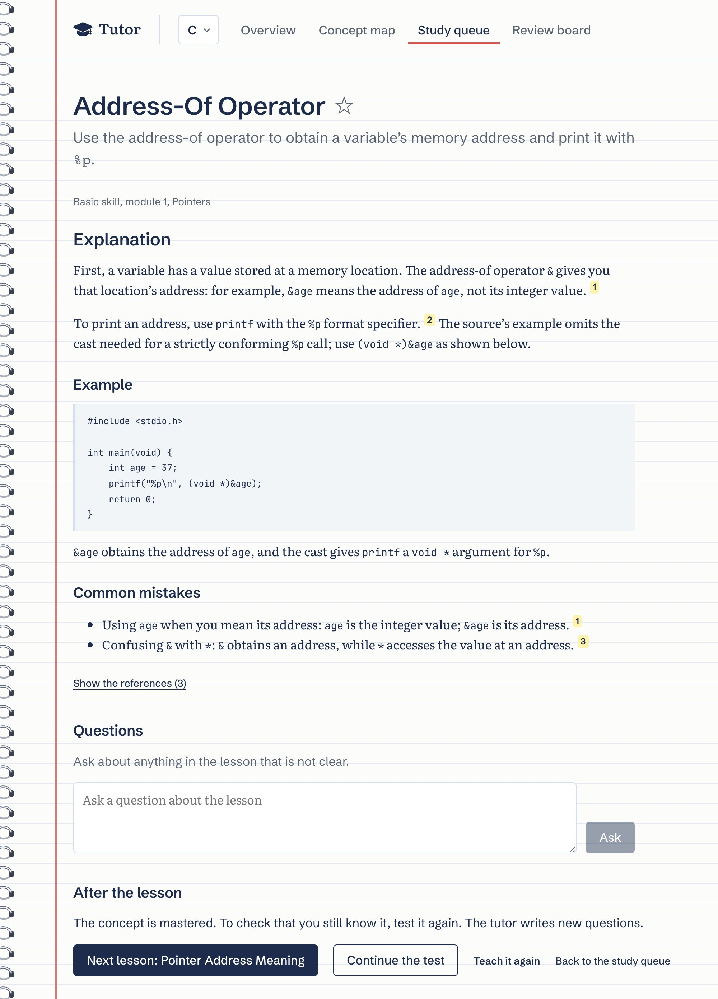
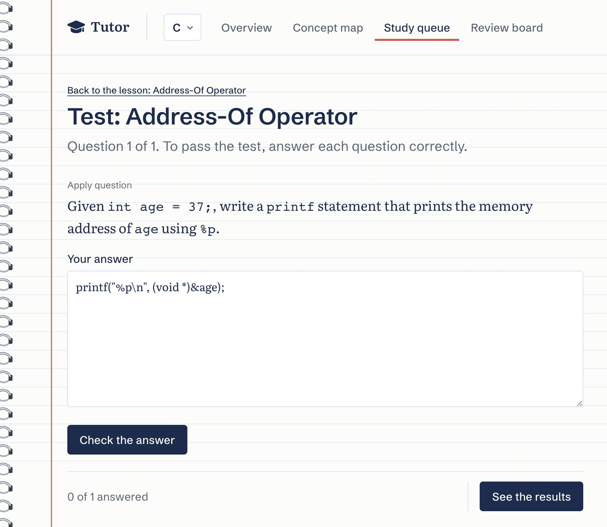
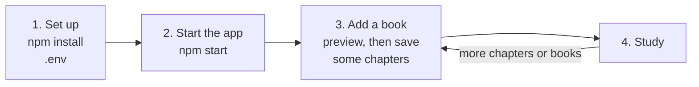

#  Tutor

> See also my other project, [Tapas Habit & Goal Tracker](https://tapastracker.app), a full-featured habit tracker for iPhone and Android. Also, **I am looking for a full-time role** as a software developer. Contact me on [LinkedIn](https://www.linkedin.com/in/demetrius-edelin/).

A personal tutor that teaches you from your books or from online documentation. You make a subject of study, for example "SQL", and add books to it. A book can be an EPUB file, a PDF file, an online book, or online documentation. The tutor finds the concepts in the books and checks which concepts you know. Then it teaches the other concepts one at a time, with references to the books, and tests each one.

The tutor runs on your computer. It uses one large language model (LLM) from Anthropic, OpenAI, or OpenRouter. You select the model.

<table>
  <tr>
    <th>Concept map</th>
    <th>Lesson</th>
    <th>Test</th>
  </tr>
  <tr>
    <td valign="top"></td>
    <td valign="top"></td>
    <td valign="top"></td>
  </tr>
</table>

## Why not a simple chat with your books?

A chat with a book answers the questions that you think of. The tutor turns your books into a course:

- **Structure.** The tutor puts the concepts of a subject into modules on a concept map. It teaches them one at a time, from a study queue.
- **All the concepts.** Ingest finds the concepts in each chapter. Then it makes sure that the concepts cover the bold and italic terms of the book.
- **Visible progress.** The concept map and the review board show the status of each concept, for example known, learning, or mastered.
- **Your control.** You select the concepts to test, to learn, and to skip. You also set the order of the study queue. The tutor only suggests.

## Quick start

You need Node.js 22 or later and an API key for Anthropic, OpenAI, or OpenRouter. We test the tutor on macOS.

```sh
git clone https://github.com/demetrius-edelin/tutor.git
cd tutor
npm install
cp .env.example .env   # then set the provider, the model, and the API key
npm run llm:check      # optional: send 3 small test requests to the model
npm start              # then open http://localhost:3000
```

In the Windows command prompt, use `copy` instead of `cp`.

Then, in the app:

1. Make a subject, for example "SQL".
2. Click "Add a book" and select an EPUB file or a tagged PDF file.
3. Select one chapter and click "Preview". The preview shows the concepts of the chapter and changes nothing.
4. If the concepts look correct, click "Save these chapters". Then start to study.

Before each run, the app shows the number of model requests. Later, click "Add chapters" next to the book to add more chapters.

## How it works

You use the tutor in four steps. Steps 1 and 2 are commands in the terminal. Steps 3 and 4 are in the app, in the browser.



1. [Set up the tutor](docs/usage.md#step-1-set-up-the-tutor). Do this one time.
2. [Start the app](docs/usage.md#step-2-start-the-app).
3. [Add a book to a subject](docs/usage.md#step-3-add-a-book-to-a-subject). Add the full book, or only the chapters that you want to study now. For an online book, [download it first with a command](docs/commands.md#download-an-online-book).
4. [Study](docs/usage.md#step-4-study). The app shows the next action at each stage.

The [usage guide](docs/usage.md) explains each step in the app. The [command reference](docs/commands.md) explains the commands in the terminal.

### In the app

In the app, you open a subject and go through these stages:

- Books: add a book, or more chapters of a book. Select the chapters, make a preview, and save it. The concept map follows the order of the books.
- Choose: on the concept map, test, learn, or skip each concept. To do this for many concepts in one step, select their checkboxes and use the bar at the bottom of the page.
- Diagnosis: the tutor asks 2 questions about each concept that you selected for a test. To start it, click "Test it" next to a concept, or select concepts and click "Test them".
- Study queue: the concepts to learn, in an order that you can change.
- Lesson and test: the tutor teaches one concept from your books, with references. Then it tests the concept with the questions that fit it: one question for a simple concept, at most 5 for a larger one. To pass, answer each question correctly. A pass makes the concept mastered.
- Review board: a list of all concepts with their status and their stars.

The model writes the questions and grades the open answers. If you think that a grade is wrong, use "Dispute the grade". A disputed answer counts as correct.

## Commands

The app does the main work. Use a command in the terminal for these tasks:

- Check the model after a change to `.env`: `npm run llm:check`.
- Download an online book or online documentation into an EPUB file: `npm run fetch`. Then add the EPUB file in the app.
- Check a book at no cost before you add it: `npm run parse`.
- Ingest some sections of a very large chapter, or ingest a chapter again: `npm run ingest` with `--sections` or `--replace`.
- Update the text of your books after an update of the tutor: `npm run refresh`.

The [command reference](docs/commands.md) explains each command and its options. The app and the commands use the same code and the same cache.

## Configuration

The tutor reads its configuration from the `.env` file. Copy `.env.example` to `.env`. The file explains each value.

| Variable | Value |
|---|---|
| `LLM_PROVIDER` | `anthropic`, `openai`, or `openrouter`. |
| `LLM_MODEL` | The model name, exactly as the provider writes it. For OpenRouter, use the form `vendor/model`. |
| `LLM_REASONING` | Optional. `none`, `minimal`, `low`, `medium`, `high`, `xhigh`, or `max`. Empty means the default of the model. |
| `OPENROUTER_PROVIDERS` | Optional, for OpenRouter only. The providers that can serve the model, in order. |
| `ANTHROPIC_API_KEY`, `OPENAI_API_KEY`, `OPENROUTER_API_KEY` | The API key of the selected provider. |

The tutor has no default model. After a change to `.env`, run `npm run llm:check`.

### Which model to use

We tested the tutor with different models. GPT-6 Luna from OpenAI, at the reasoning level `high`, gave the best results. It was also the cheapest model in our tests, and it is very smart for a model in its price range.
**Update, October 2026:** Claude Haiku 5.5 from Anthropic has now the same price as GPT-6 Luna, but it gives much better results!
```
LLM_PROVIDER=anthropic
LLM_MODEL=claude-haiku-5-5
LLM_REASONING=high
```
 If you use OpenAI, use these values:

```
LLM_PROVIDER=openai
LLM_MODEL=gpt-6-luna
LLM_REASONING=high
```


### Cost

The tutor uses your API key, so your provider charges you for each request.

- Ingest makes the most requests, because the model reads each chapter and each image of the book. Before each run, the app shows the number of requests.
- The tutor keeps the model results of each chapter and each image in a cache. A later run does not pay again for the chapters in the cache.
- In the app, the diagnosis, the lessons, the questions about a lesson, and the tests use the model.
- A high reasoning level makes each request slower.

### Port

The app uses port 3000. To use a different port, set `PORT` in the shell. The tutor does not read `PORT` from `.env`.

```
PORT=8080 npm start
```

## Books

- EPUB files work best. The parser reads the publisher CSS for headings, bold, and italic.
- PDF files must be tagged. Word and many publishing tools make tagged PDF files. The parser stops with a clear message for an untagged or a scanned PDF.
- Some books show code or tables as images. Ingest uses the model to read them. If the model does not accept images, the images stay as placeholders.
- Online books and online documentation: `npm run fetch` downloads the pages into an EPUB file. Then you add the file in the app. The command cannot read pages behind a login, or pages that show their text only after JavaScript runs. See [Download an online book](docs/commands.md#download-an-online-book).

## Common questions

- **Must I add the full book?** No. Select only the chapters that you want to study now. Later, click "Add chapters" next to the book.
- **What is the difference between "Preview" and "Save"?** A preview shows the concepts of the chapters and does not change the concept map. A save puts the concepts on the concept map, and the app shows them at once.
- **Do I pay two times for the chapters of a preview?** No. The tutor keeps the model results of each chapter in a cache. A save after a preview makes only one merge request for each chapter.
- **Can I leave the page during a run?** Yes. The run continues on the server. The subject screen shows the run, with a link to its progress. Only one run can work at a time.
- **What does "Stop" do?** The run ends after the current model request. The finished chapters stay in the cache, so a new run does not pay for them again. A stopped run does not change the concept map.
- **In which order does the concept map show the concepts?** In the order of the books, the chapters, and the sections. The order in which you add the chapters does not change it.
- **Can I move or delete the book file after I add it?** Yes. The tutor keeps a copy of the book file in the folder of the book.
- **Can the tutor teach from online documentation?** Yes. Download it with `npm run fetch`, then add the EPUB file in the app. See [Download an online book](docs/commands.md#download-an-online-book).
- **How do I add a second book to a subject?** On the subject screen, click "Add a book". The tutor adds the concepts of the new book to the concept map of the subject.
- **How do I make a new subject?** On the list of subjects, type a name in the "New subject" field. Then click "Create".
- **How do I delete a subject?** On the list of subjects, click "Delete" below the subject. Then click the red button in the panel that opens. The tutor deletes the books, the concepts, your progress, and the folder of the subject. You cannot undo this.
- **Can I add books without the app?** Yes. The `ingest` command uses the same code as the app. It also has options that the app does not have. See [Ingest a book from the terminal](docs/commands.md#ingest-a-book-from-the-terminal).
- **Can I delete `data/parse/`?** Yes. Only the `parse` command writes it, and nothing reads it.

## Status and roadmap

The tutor is at version 0.1.0. All the app stages and the commands in this README and in the guides work. The tutor is for one person on one computer.

Planned:

- Add an online book from the app. Now you download it with a command, then you add the EPUB file in the app.
- A container image, to run the tutor on your own server.

## Development

| Command | What it does |
|---|---|
| `npm run dev:server` and `npm run dev:app` | Run the server and the app with live reload. Use two terminals. |
| `npm test` | Run the tests. The tests use a fake model client, so they do not call a model. |
| `npm run test:watch` | Run the tests again after each change. |
| `npm run typecheck` | Check the TypeScript types of the server and of the app. |

### Tech stack

| Part | Tools |
|---|---|
| Language | TypeScript on Node.js 22. |
| Server | Fastify. |
| App | React 19 and Vite. |
| Database | SQLite, with better-sqlite3. |
| Book parser | JSZip and cheerio for EPUB, pdf.js for PDF, and Turndown for Markdown. |
| Online books | The fetch function of Node.js, cheerio, marked for Markdown pages, and JSZip for the EPUB file. |
| Model clients | The Anthropic SDK and the OpenAI SDK. OpenRouter uses the OpenAI SDK. |
| Tests | Vitest. |

### Project layout

```
src/
  cli/          command-line scripts
  config.ts     reads .env
  db/           SQLite schema
  ingest/
    core/       blocks, sections, Markdown, checklist (all formats)
    epub/       EPUB reader
    pdf/        tagged PDF reader
    stages/     extract, review, and merge (the model stages)
    web/        online books: table of contents, pages, and the EPUB writer
  llm/          model client for Anthropic, OpenAI, and OpenRouter
  tutor/        diagnosis, lessons, questions, grader, and study queue
  server/       HTTP API
  app/          browser app (React)
docs/           usage guide and command reference
test/           tests, a fake model client, and a builder for test EPUB files
data/           your books, the results, and the database (not in git)
```

## AI assistance

I built Tutor with Claude Code. All the product and design decisions are mine, and I tested each milestone carefully with real books. Claude wrote the code and most of the documentation.

## Contributing

Pull requests are welcome. For a large change, open an issue first, so that we can agree on the approach.

Before you send a pull request, do these steps:

1. Run `npm test`. All tests must pass.
2. Run `npm run typecheck`. It must show no errors.

## Privacy and copyright

- Do not commit `data/` or `.env`. Git ignores them.
- The `data/` folder contains a copy of each book file that you add, the text of these books, and the online books that you downloaded.
- The `fetch` command obeys `robots.txt` and waits one second between two requests.
- The repository contains no book text. The tests build their own small EPUB file in code.
- When the tutor sends a request, it sends book text to the provider that you selected. With OpenRouter, the text goes to the vendor of the selected model.

## License

[MIT](LICENSE)
